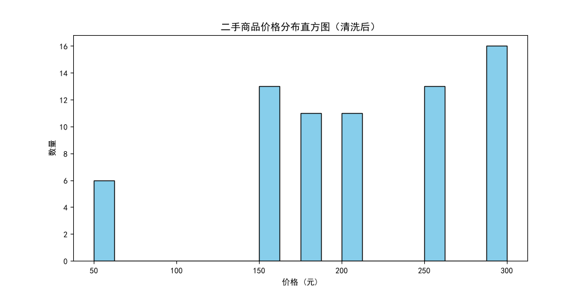

# 二手交易市场数据采集与异常值分析系统

## 📖 项目简介
本项目是一个基于 Python 的二手商品数据采集与清洗分析工具，旨在解决二手交易平台中由于卖家随意标价（如1元引流、9999元传家宝）导致的市场均价失真问题。

## 🛠️ 技术栈
- **数据采集**：Requests, BeautifulSoup4 (支持基础反爬策略)
- **数据处理**：Pandas, NumPy (利用统计学方法剔除异常价格)
- **数据可视化**：Matplotlib

## 📊 运行结果
- 原始抓取数据：500 条
- 清洗后有效数据：262 条
- 商品平均价：196.29 元，中位数价格：202.0 元
- 各城市均价对比（北京 229.2 / 上海 214.6 / 广州 189.2...）

## 🖼️ 可视化图表
**
